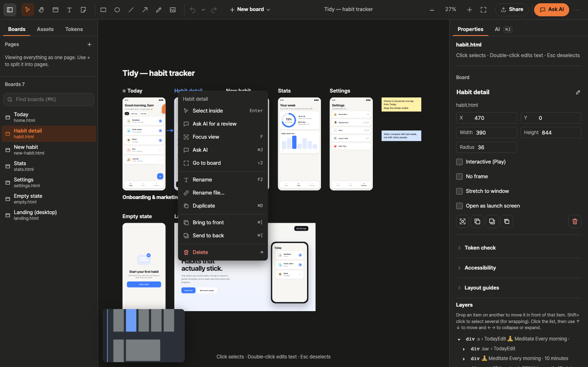

<div align="center">

# Easel

**An infinite canvas for HTML screens. Your AI agent writes the designs; you see and tweak them live.**

[](https://www.npmjs.com/package/easel-canvas)
[](LICENSE)
[](package.json)
[](#connect-your-ai-agent)
[](#connect-your-ai-agent)


<sub>A real Claude Code run on the bundled demo (the agent's thinking time is sped up 4×).</sub>

</div>

Easel turns a folder of plain HTML files into a design canvas. Claude Code or Codex writes a screen, and it shows up on the canvas a moment later. Drag, resize, retype or restyle anything on the canvas, and **only that part of the source file changes**. There is no export step and no proprietary file format: your designs stay in your repo as HTML and merge with git like any other code.

## Try it in 30 seconds

```bash
npx easel-canvas --demo
```

That copies the "Tidy" habit tracker demo to `./easel-demo` and opens it at http://localhost:4317. Open the **AI** tab (⌘J) and ask Claude Code or Codex for a change, or click anything on a screen and start editing.

Already have HTML screens? Run it in your project:

```bash
npx easel-canvas                  # opens ./docs/design (or the current folder if it has screens/)
npx easel-canvas --init           # starts a new ./docs/design with one screen
npx easel-canvas --dir ./designs  # any folder of screens/*.html
```

## Why Easel

- **HTML is the source of truth.** Each `screens/*.html` file is one board. What you see is exactly what ships to the browser, and there's nothing to export or keep in sync.
- **Built for AI agents.** An MCP server with 20 tools lets agents see the boards, read what you selected, leave comments, check tokens and arrange the canvas. An in-app chat runs `claude -p`, `codex exec`, `cursor-agent -p`, `gemini -p` or your own command with your selection as context; Claude Code's permission requests come up as cards you answer in the chat.
- **Surgical edits.** Changes are patched into the exact source range (parse5 locations), so formatting, comments and the rest of the file stay untouched. If an agent edits the same element first, your edit is rejected instead of overwriting it.
- **Git-friendly by design.** Layout, notes and comments live in small JSON files written one entry per line, so two branches moving different boards merge without conflicts.
- **Local-first.** It runs on `127.0.0.1` and works directly on the files in your repo. No account, no cloud, no lock-in.

## Features

<table>
  <tr>
    <td colspan="2"></td>
  </tr>
  <tr>
    <td width="50%"></td>
    <td width="50%"></td>
  </tr>
  <tr>
    <td><b>Edit in place.</b> Select any element, drag it, resize it, align it, retype its text or change its styles. Layers, wrap in flex/grid, cross-board copy and paste.</td>
    <td><b>Chat with your agent.</b> Pick Claude Code or Codex, send the selection, boards and comments as context, watch the edit stream in, ask for N variants side by side.</td>
  </tr>
  <tr>
    <td width="50%"></td>
    <td width="50%">
      <b>Everything a canvas should do.</b>
      <ul>
        <li>Pan, zoom and minimap; thumbnails keep ~100 boards smooth (60 fps)</li>
        <li>Notes, sticky notes, shapes, arrows and images</li>
        <li>Pages, layout guides, focus view and Play in place</li>
        <li>Design tokens with off-token warnings and an accessibility check</li>
        <li>Comments with replies, git snapshots, and one undo history for canvas actions and HTML edits</li>
        <li>Context menus and keyboard shortcuts for everything; light and dark themes</li>
      </ul>
    </td>
  </tr>
</table>

## Connect your AI agent

Keep the canvas running (`npx easel-canvas`). Agents write HTML files directly, and what they change shows up in the canvas's undo history (one step per in-app AI request, or per burst of edits from an outside agent); the MCP server lets them **see** (`list_boards`, `read_board`, `screenshot`, `list_errors`), **know what you mean** (`get_selection` with the selected element, visible boards and the current page), **talk** (comments and replies) and **arrange** (`place_board`, `create_board`, notes, pages, `check_tokens`, `save_snapshot`). When several agents share a canvas, `claim_board` (before editing a file with their own tools) or `write_board` (a whole board through Easel) keeps one writer per board: a second agent on a busy board is given a fork next to it and told which file it is on.

Then, in your project folder:

```bash
npx easel-canvas connect
```

It adds the Easel MCP server to your agents' configs and leaves everything else in those files as it was: `.mcp.json` (Claude Code), `.cursor/mcp.json` (Cursor) and `.gemini/settings.json` (Gemini CLI) in the project, and `[mcp_servers.easel]` in `~/.codex/config.toml` (Codex). Cursor, Gemini CLI and Codex are written only when they are found on your machine; pick agents with `--agents claude,cursor,gemini,codex`, or preview with `--dry-run`. Restart your agent afterwards.

There is no port to set: the MCP server finds the canvas running for the folder your agent works in (each canvas registers itself in `~/.easel/servers/`), and a busy port 4317 simply moves the canvas to the next free one. With several canvases open outside any of their projects, pass `--port <n>` to `easel-mcp` to pick one.

<details>
<summary>Manual setup</summary>

**Claude Code** (`.mcp.json` in the project root), **Cursor** (`.cursor/mcp.json`), **Gemini CLI** (`.gemini/settings.json`):

```json
{ "mcpServers": { "easel": { "command": "npx", "args": ["-y", "-p", "easel-canvas", "easel-mcp"] } } }
```

**Codex** (`~/.codex/config.toml`):

```toml
[mcp_servers.easel]
command = "npx"
args = ["-y", "-p", "easel-canvas", "easel-mcp"]
default_tools_approval_mode = "approve"  # the tools only view, comment and arrange
```

Add `"--port", "4317"` to `args` to pin one canvas instead of finding it by folder.

</details>

Using Easel as a submodule (below)? Point `args` at `tools/easel/bin/mcp.mjs` with `"command": "node"` instead.

Then try:

> "Fix what I selected on the canvas: make the button text shorter."
> "Make three variants of the Stats screen."
> "Create an onboarding screen at 390×844 and put it next to Today."

New files with `<meta name="board-size" content="390x844">` are placed on the canvas automatically at that size.

## Share a view-only copy

**Share** in the toolbar writes a static, read-only copy of the whole canvas, the current page or the selected boards to `<project>/easel-export/`: boards with their pages, notes and comments, Play, and a stamp with the export time and `repo@commit`. Nothing in it calls back to Easel, so any static host works (Vercel, GitHub Pages, a PR preview, under any sub-path), and `index.html` also opens straight from disk (comment pins then stack in their board's corner, because browsers keep `file://` frames apart). **Copy deploy command** gives you `npx vercel deploy easel-export`. Turn on **One .html file** for a single self-contained file to attach to Slack, email or a PR; its size shows before you save. **PDF** (one board per page) and **PNG** (one 2× image per board) need Playwright's Chromium.

The same from the terminal, with no canvas running (it works in CI):

```bash
npx easel-canvas export                          # web folder in ./easel-export
npx easel-canvas export --single-file            # one self-contained .html
npx easel-canvas export --page Onboarding --pdf --png
npx easel-canvas export --boards home.html,stats.html --out dist/design-preview
```

Exporting again replaces what the previous export of the same kind wrote there (a small `.easel-export.json` lists it) and leaves anything else in the folder alone; a non-empty folder Easel did not create is never cleared. Dot folders (`.easel/`, `.thumbs/`…) and files outside the design folder are never copied. A single file inlines the screens' images, fonts, CSS and scripts but not HTML embedded with `<iframe>`; the export lists what it skipped.

## Pin it in your project

`npx easel-canvas` is all most projects need. To pin an exact version for your team, add it as a dev dependency (`npm i -D easel-canvas`, then `"design": "easel-canvas"` in your scripts) or as a git submodule. With your designs in `<project>/docs/design/screens/`:

```bash
git submodule add https://github.com/nemodleo/easel.git tools/easel
```

```json
{
  "scripts": {
    "design:install": "git submodule update --init tools/easel && npm --prefix tools/easel install",
    "design": "npm --prefix tools/easel start"
  }
}
```

```bash
npm run design:install   # once: fetch the submodule and install
npm run design           # http://localhost:4317
```

- The default design folder is `../../docs/design` relative to the tool, so `tools/easel` opens your `docs/design` with no flags. Anywhere else: `npm --prefix tools/easel start -- --dir <design folder> --port <port>`.
- It installs separately from your app, so it never touches your app's dependencies, build or deploy, and CI that skips submodules (the `actions/checkout` default) is unaffected.
- To update: push to this repo, then run `git submodule update --remote tools/easel` in your project and commit the new pointer. Teammates run `npm run design:install` after `git pull`.


<details>
<summary><b>Keyboard shortcuts and how-tos</b></summary>

| To do this | How |
| --- | --- |
| Pan and zoom | Drag empty space, Space, or Hand (H); trackpad scroll; ⌘+wheel or pinch (4–400%). ⇧1 Fit all, ⇧2 selection, ⌘0 Zoom to 100%, Minimap (M) |
| Find | Left "Boards" tab: ⌘K search and list; pages (drag to reorder; right-click to rename, delete, or set the launch page) |
| Boards | Draw with the board tool (B), use a "New board" template (Blank · Mobile screen · Desktop screen · Document), or drop an HTML file on the canvas. Duplicate ⌘D, rename F2 (renaming the file offers to update references), Delete (confirm, trash, undo), Bring to front / Send to back ⌘] ⌘[ |
| Multiple items | Drag on empty space to marquee-select or use Shift; move together (snap guides, Alt to disable); arrow keys 1, Shift 10, Option 100 |
| Board options | Right "Properties": position, size, Radius, No frame, Interactive (Play), Stretch to window, Open as launch screen, Layout guides (Columns · Rows · Grid, up to 6, ⌃G), Adjustable values |
| View | Focus view (F, ←→), Play in place (P or ▶, Esc), Play full screen (right-click) |
| Notes and shapes | Title (T), sticky note (N, 8 colors, size, bold, italic), Rectangle (R), Oval (O), Line (L), Arrow (A), Pen (P when no board is selected), image (Assets or paste) |
| Select elements | No mode to enter: click anything on a board (drag the board to move it). Shift-click or Shift-drag for several, Esc lets go (then of the board), ↑ parent, ↓ or Enter first child, ←→ siblings, Option+↑↓ to reorder, ⌘A for all siblings, ⌘G Wrap in flex, Tab into the element toolbar |
| Direct editing | A toolbar over the selection: Text (size, weight), Fill (your tokens first, written as a CSS variable, then Custom), Radius, Spacing (padding, gap), Ask AI, Comment. Double-click text to edit it (Shift+Enter for a line break). Move with handles (Alt drops inside a box) and resize, 6 align options, Properties panel in design words with the breadcrumb (CSS names on hover, everything else under More (CSS), ⚠, contrast), Replace image, ⌘C/⌘V to paste into another board |
| Undo | ⌘Z / ⌘⇧Z. Canvas actions, HTML edits and board create/delete share one history (100 entries). The ▾ next to Undo lists it newest first (who, what, when; Now marks where you are): Go back to here undoes or redoes step by step to that entry, and Redo brings the rest back. The history lasts until Easel restarts |
| Who changed what | A board changed by someone else (an agent over MCP or the in-app chat, a file edited outside Easel, another browser) gets a tag above its title, e.g. "Codex · 2m · 1 change", in that author's colour, and the changed element is outlined. Click the tag: the change ("Get started" → "Start free"), Before / After, and Undo (only that change; asks first if one of its boards changed since). Tags fade once you open them or select the board, and clear a day later |
| Design system | Register tokens (`tokens.json`) and themes in the left "Tokens" tab, Theme menu in the toolbar, Token check and Accessibility lists on the right |
| Collaboration | Comments (Reply, Resolve, author), Snapshot menu (git-commits only the design folder) |
| Share | Toolbar "Share": whole canvas, this page or the selected boards as a web folder or one .html file, PDF or PNG; Reveal, Copy deploy command, and the matching `npx easel-canvas export` line |
| Who is on which board | A board someone is editing says so above its title, in their colour: "Claude Code is editing…", "You · editing", then "Claude Code · done 13:52"; the board list shows the same dot. An agent holds a board from its first write until its in-app run ends, or 45 s after its last write over MCP (or when it disconnects). A second agent writing a board another agent holds works on a fork beside it ("Welcome · Codex"), with an arrow back that says when and why; you are never forked. When both are done, Use this one on either keeps that version under the original's name, title, position and comments, and sends the other to trash; one Undo brings both back |
| Pick a variant | Variants from the AI tab land in the first free row (never on notes or boards) and each gets Use this: Apply makes it the original board and sends the other variants to trash (toast with Undo), Keep all leaves them as ordinary boards |
| AI | Right "AI" tab (⌘J): Claude Code, Codex, Cursor Agent, Gemini CLI, or your own command; selection, boards, visible boards, comments and references go along as context; N variants; Ask AI for a review |
| AI permissions | When Claude Code wants to run a command or edit outside what it may, the chat shows the exact request: Allow once, Always allow (that tool, or a command's first two words, until Easel restarts; never for file edits, for commands with `;` `&&` `\|` `>` and the like, or for `sh -c`-style wrappers), or Deny |
| Undo an AI run | Each run that changed files ends with the boards it changed and added: Undo this run (one step, ⌘Z brings it back; asks first if you changed one of them since), Redo, Compare before and after. After a restart: Restore the copy from before this run (the newest 10 are kept) |
| Custom agent | Agent menu › Custom command…: a name and a command with `{prompt}`, e.g. `aider --message {prompt} --yes`. Saved in `~/.easel/agents.json` (not in the project), run without a shell, output shown as plain text |
| Screen | F6 to move between regions, Tab to move between boards, ⌘\\ to hide panels, Appearance (System · Light · Dark) |

</details>

## How it works

```
your-project/docs/design/
├── screens/*.html   ← one board per file; agents and you both edit these
├── board.json       ← positions, titles, pages, notes, shapes (one line per entry)
├── comments.json    ← comment threads pinned to elements
└── tokens.json      ← optional design tokens and themes
```

- A small Node server watches the folder (chokidar) and tells the browser which board changed, so only that board reloads, keeping scroll and selection.
- Element paths and hashes are computed from the source with parse5. Every edit is a minimal string patch into that range, written atomically.
- The canvas is a Vite + React app. Each board is an iframe of the real HTML, so scripts, links and CSS behave exactly as in a browser.
- The server listens on 127.0.0.1 only and refuses changes (and the live connection) from other web pages open in your browser: only requests with no `Origin` (the CLI, the MCP server) or from the canvas page itself, on a local host name, get through. Boards are your project's own HTML and run inside the canvas page, with the same access to it as you have, so open only design folders you trust.

## Development

```bash
npm test             # unit tests (source patching, board format, chat parsing, tokens…)
npm run test:e2e     # Playwright end-to-end tests against test/fixtures/design
npm run typecheck
npm run demo         # run the repo's demo from source
```

- `test/fixtures/design/` intentionally keeps Korean screen content and board titles: it mimics real user content and is needed to test Korean text input (IME) and rendering. Set `DESIGN_CANVAS_E2E_DIR=<folder>` to run the e2e tests against another design folder.
- `examples/demo/` is the "Tidy" demo used for the screenshots above.

| Folder | Contents |
| --- | --- |
| `bin/` | `server.mjs` (app server), `mcp.mjs` (MCP stdio server) |
| `server/` | API and routes, board.json, file watching, element paths and hashes, source patching, history, chat runner, tokens |
| `app/` | Canvas UI (Vite + React + TypeScript); all UI text lives in `app/src/strings.ts` |
| `test/` | `node --test` unit tests and Playwright e2e tests |

Background reading: the original plan is in [PLAN.md](PLAN.md), a feature-by-feature comparison with Claude Design is in [PARITY.md](PARITY.md), and the work log is in [tasks.md](tasks.md).

Contributions are welcome: open an issue or a pull request.

## License

[MIT](LICENSE) © Hyun Park
